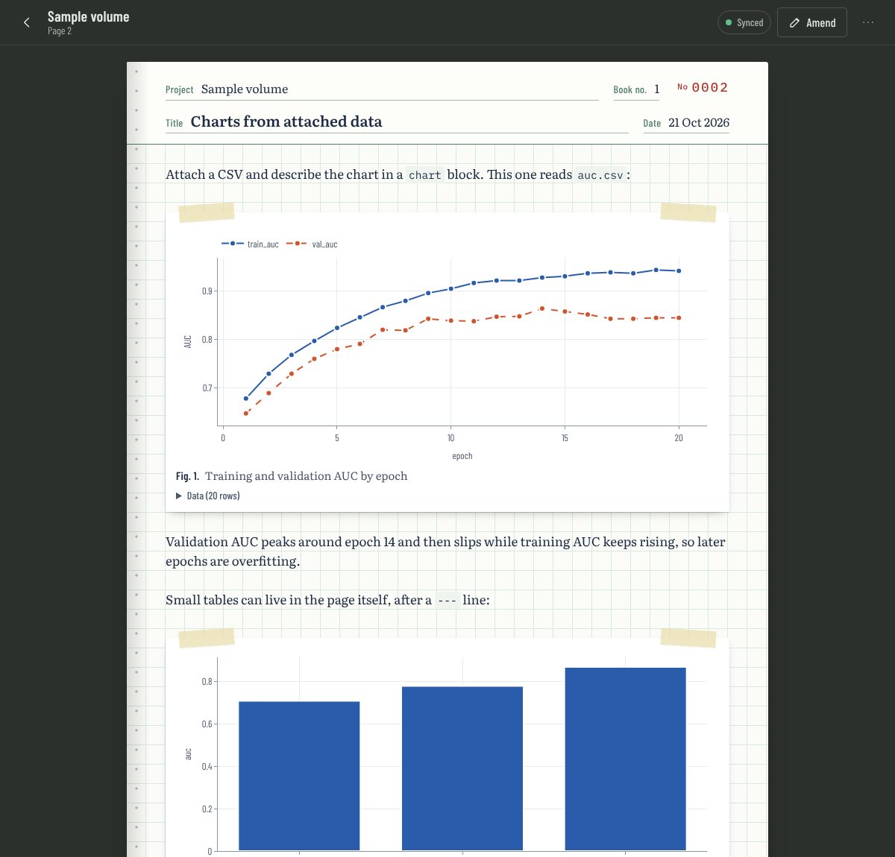
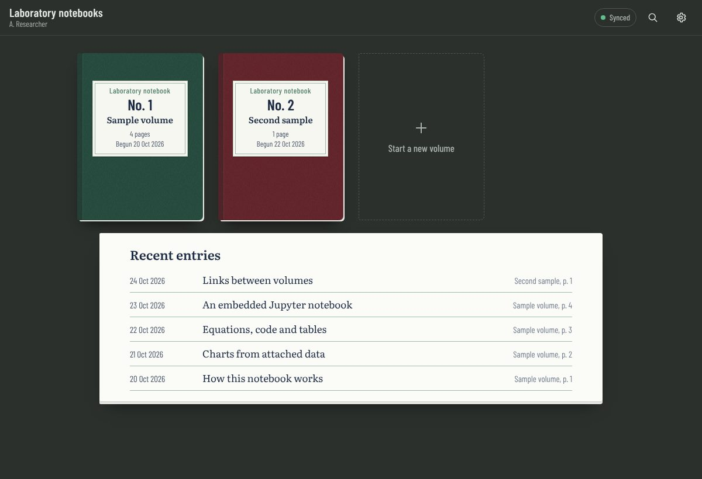
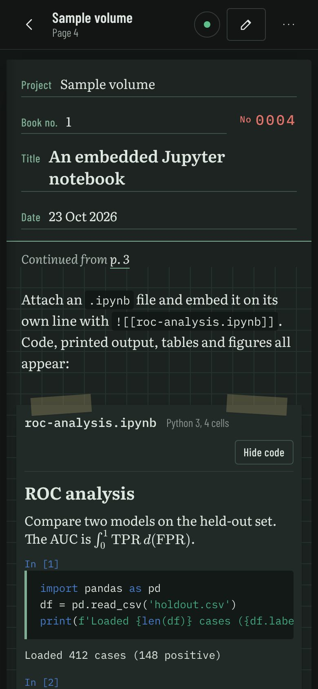

# Lab Notes for All

A laboratory notebook that runs in your browser and keeps every entry in a **private GitHub repository you own**. It has quad-ruled pages that are numbered, dated and signed, one volume per project, and it works on your phone, tablet and computer, including offline.

There is no server, account or subscription. The app is a static web page. Your notes go straight from your browser to your own GitHub repository, and every save is a Git commit, so each page keeps its full history.



<p align="center">
  
  &nbsp;
  
</p>

**Try it without setting anything up:** open the sample notebook at https://johnyquest7.github.io/Lab-notes-for-all/?demo. Nothing you change there is saved.

## What it does

- **Volumes and pages**: each project gets a volume with a contents page, and pages are numbered within the volume.
- **Writing**: you write in Markdown. Drafts are kept on the device as you type.
- **Signing**: **Sign & save** records your name and the time. Editing a signed page adds a dated amendment, and Git keeps the earlier version.
- **Charts**: attach a CSV, TSV or JSON file, or paste rows into the page. You get line, scatter, bar, histogram, box, violin and heatmap charts, with the data table one click away.
- **Math and code**: `$inline$` and `$$display$$` equations (KaTeX), and syntax-highlighted code blocks.
- **Jupyter notebooks**: embed an `.ipynb` file to show its code, output, tables and figures.
- **Images**: paste screenshots or photos straight into the editor. They appear taped in like printouts.
- **Linking**: `[[12]]` links to page 12, `[[other-volume/3]]` to another volume, and every page lists the pages that refer to it.
- **Search**: full-text search with `#tags`. Press `/` or Ctrl/Cmd-K.
- **Printing**: print or save a single page as a PDF, or a whole volume with its cover and contents.
- **Offline**: install it as an app on your phone. Pages saved offline sync when you reconnect. If the same page was changed on another device, it asks you which version to keep.
- **Night paper**: a dark mode that follows your device or can be set by hand.

## Install

You need a free GitHub account. Setup takes about ten minutes, and you do it only once.

### 1. Get your own copy of the app

Click **Fork** at the top of this page, then **Create fork**. You now have `your-name/Lab-notes-for-all`.

The app's code can stay public, because your notes never go into this repository.

### 2. Publish it with GitHub Pages

In your fork:

1. Open **Settings → Pages**.
2. Under **Build and deployment**, set **Source** to *Deploy from a branch*.
3. Choose the `main` branch and the `/ (root)` folder, then click **Save**.

After a minute or two your notebook is live at:

```
https://your-name.github.io/Lab-notes-for-all/
```

(The address is also shown at the top of the Pages settings once it is ready.)

### 3. Create a private repository for your entries

1. Go to https://github.com/new.
2. Name it something like `lab-notebook-entries`.
3. Choose **Private**. This matters: anything in a public repository can be read by anyone.
4. Click **Create repository**. Leave it empty; the app sets it up.

### 4. Connect each device

Do this on every phone, tablet or computer you want to use.

1. Open your notebook address from step 2.
2. Type your entries repository as `your-name/lab-notebook-entries`.
3. Tap **Create a token on GitHub**. GitHub opens a new *fine-grained personal access token* form, already filled in with:
   - a name and description,
   - an expiry of one year,
   - **Repository permissions → Contents: Read and write**.

   Under **Repository access**, choose **Only select repositories** and pick your entries repository. Then click **Generate token** and copy it.
4. Paste the token into the app and tap **Connect notebook**.
5. The first time only, enter your name as you want it to appear on signed pages and tap **Start the notebook**.

Each device gets its own token. If you lose a phone, delete that device's token at https://github.com/settings/personal-access-tokens and the others keep working. When a token expires, the app tells you, and you create a new one from **Settings → Create a new token**.

### 5. Install it as an app (optional, recommended on phones)

- **iPhone / iPad (Safari):** tap Share, then **Add to Home Screen**.
- **Android (Chrome):** tap the menu, then **Install app** (or **Add to Home screen**).
- **Desktop (Chrome or Edge):** click the install icon at the right end of the address bar.

Installed, it opens full screen and works offline.

### Keeping your copy up to date

When this project gets improvements, open your fork on GitHub and click **Sync fork → Update branch**. GitHub Pages republishes automatically, and your entries are not affected.

## Writing guide

### Pages

Write Markdown in the editor. The toolbar inserts headings, lists, checklists, equations, code, tables, charts and page links, and the paperclip attaches files. On a wide screen the preview sits beside the editor; on a phone, switch between **Write** and **Preview**.

Use **Continue on a new page** (in a page's ⋯ menu) when an entry runs long. The two pages are linked with "Continued from / Continued on" notes.

### Charts

Attach a CSV and the app inserts a chart block for it. You can also write one yourself:

````markdown
```chart
type: line            # line, scatter, bar, histogram, box, violin, heatmap
data: results.csv     # an attached file
x: epoch
y: train_auc, val_auc # one or more columns; omit to plot every numeric column
error: val_sd         # optional error bars
group: model          # optional: one series per value of this column
title: AUC by epoch
ylabel: AUC
logy: true            # optional log scale (also logx)
```
````

For small tables, put the rows in the page after a `---` line instead of attaching a file:

````markdown
```chart
type: bar
x: model
y: auc
---
model,auc
Baseline,0.71
Model A,0.87
```
````

### Attachments

| Syntax | Result |
|---|---|
| `` | An image, taped in as a numbered figure |
| `![[analysis.ipynb]]` | A Jupyter notebook with its outputs |
| `![[data.csv]]` | The file shown as a table |
| `[protocol.pdf](protocol.pdf)` | A link that opens the file |

### Links and tags

- `[[12]]` links to page 12 of the same volume.
- `[[12|the pilot run]]` uses your own link text.
- `[[other-volume/3]]` links across volumes. The volume's name in links is its folder name, shown in **Volume details**.
- Index terms (tags) go in the field under the title. Search for them with `#tag`.

## How your entries are stored

Everything is plain files you can read, edit or back up with any Git tool:

```
notebook.json                           notebook title, your signing name, the list of volumes
volumes/<volume>/index.json             search index for the volume (maintained by the app)
volumes/<volume>/pages/0001.md          one Markdown file per page
volumes/<volume>/attachments/0001/      files attached to page 1
```

A page file looks like this:

```markdown
---
title: Tile size ablation
date: 2026-10-24
tags: [ablation, tiles]
continues: 41
signed: "2026-10-24T16:20:00-05:00"
signer: A. Researcher
---

The body of the page in Markdown.
```

You can add or edit pages from a computer and push them. The app picks up the changes on its next sync. If search results look out of date after editing many files by hand, use **Settings → Rebuild search index**.

## Privacy and security

- Your entries live only in your private repository, and the app talks only to `api.github.com` to read and write them.
- Each device stores its own token in that browser's local storage. Fine-grained tokens limited to one repository can't touch anything else in your GitHub account. **Settings → Disconnect this device** removes the token and the cached pages.
- Anyone who can open the device and the app can read the notebook. Use your device's screen lock.
- The page loads its open-source libraries (marked, DOMPurify, KaTeX, highlight.js, Plotly, PapaParse) from the jsDelivr CDN with pinned versions and integrity checks, and its fonts from Google Fonts. Those services see ordinary page requests, but none of your notebook content.
- GitHub is not a certified store for regulated data. Don't put protected health information, patient identifiers or other regulated data in the notebook unless your institution has approved GitHub for that purpose.

## Other ways to run it

**On your own computer.** No build step is needed; any static file server works:

```sh
git clone https://github.com/your-name/Lab-notes-for-all.git
cd Lab-notes-for-all
python3 -m http.server 8000
```

Then open http://localhost:8000.

**Other hosting.** Upload the files to any static host (Netlify, Cloudflare Pages, an internal web server). It must be served over HTTPS for installing and offline use.

**GitHub Enterprise Server.** Set the API address under **Settings → Connection → Advanced**, and add that address to the `connect-src` list in the Content-Security-Policy tag in `index.html`.

## Troubleshooting

| What you see | What to do |
|---|---|
| "GitHub rejected this token" | The token was copied incompletely, has expired, or was deleted. Create a new one. |
| "This token can't see owner/repo" | When creating the token, choose **Only select repositories** and pick the entries repository. Check the spelling of `owner/name`. |
| "This token can read the repository but not change it" | Edit the token on GitHub and set **Contents** to **Read and write**. |
| The sync indicator says **Needs your attention** | A page was changed on two devices. Tap the indicator and choose which version to keep. |
| The Pages address shows a 404 | Wait a few minutes after turning on Pages, and check that the source is `main` / `(root)`. |
| A page edited on another device hasn't appeared | Tap the sync indicator, then **Sync now**. |

## For developers

The app is plain HTML, CSS and JavaScript modules, with no framework and no build.

```
index.html              page shell, Content-Security-Policy, library tags
css/notebook.css        the whole look, light and dark
js/app.js               routing and views (library, contents, page, editor, search, settings)
js/store.js             GitHub storage, local cache (IndexedDB), offline queue
js/model.js             page file format, page references
js/render.js            Markdown, math, charts, attachments, Jupyter rendering
js/search.js            full-text search
js/demo.js              the sample notebook shown with ?demo
sw.js                   service worker for offline use
```

Each save is a single commit made through GitHub's Git Data API (blobs, a tree, a commit, then a fast-forward of the branch). A page, its attachments and the volume's search index therefore always change together. If the branch moved in the meantime, the save is rebuilt on top of the newer commit.

Issues and pull requests are welcome.

## License

[MIT](LICENSE)
